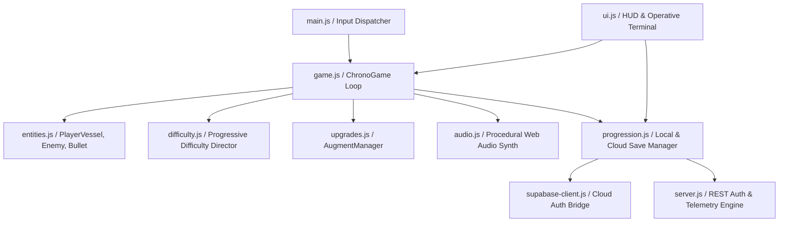
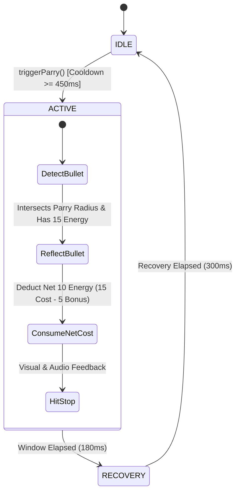

# CHRONO SURGE // TECHNICAL ARCHITECTURE

## 1. TECHNOLOGY STACK OVERVIEW
- **Game Engine & Rendering:** Custom 2D HTML5 Canvas rendering pipeline paired with Three.js WebGL background grid and particle shader pass.
- **Client Architecture:** Vanilla modern ES6+ modular JavaScript with strict state separation (`game.js`, `entities.js`, `difficulty.js`, `upgrades.js`, `progression.js`, `audio.js`, `ui.js`, `supabase-client.js`).
- **Audio Pipeline:** Low-latency Web Audio API procedural synthesis engine with dynamic low-pass filters for time dilation and combat chords.
- **Backend Infrastructure:**
  - Production Node.js server (`server.js`) with atomic file-backed JSON database engine (`db.json` + `db.bak`), salted PBKDF2/SHA-256 cryptographic hashing, and REST API.
  - Serverless PostgreSQL / Supabase architecture (`docs/supabase_schema.sql`, `public/js/supabase-client.js`) enabling direct cloud auth and database telemetry on static GitHub Pages.
- **Testing Framework:** Node.js native test runner (`node --test tests/*.test.js`) with 22 automated integration tests.
- **Deployment & Hosting:** GitHub Actions CI/CD deploying static assets to GitHub Pages (`athulvk23.github.io/chrono-surge/`).

## 2. CLIENT MODULE SYSTEM

## 3. CHRONO ENERGY & PARRY STATE MACHINE

## 4. PERSISTENCE LIFECYCLE
1. **Guest Profile:** Stored in browser `localStorage` under `chrono_surge_beginning_save_v2` with automated backup copy (`_bak`).
2. **Account Linking:** When an operative registers or logs in with unique callsign / email or Google OAuth, existing guest shards, level, unlocked skins, and records are safely migrated without duplication.
3. **Cloud Sync:** Authenticated sessions sync profile blobs to the database following completed runs or armory purchases.
